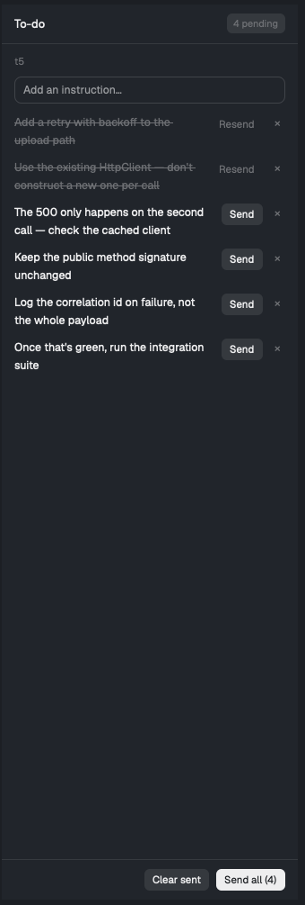

# Prompt Queue — a send queue for the agent you're looking at

A Herdr mod. You jot instructions as they occur to you while an agent works,
and send them when you're ready — one at a time, or all at once.



The point is capturing your own train of thought without interrupting the
agent. Think of something halfway through a run, write it down, keep reading.
Send when it's useful. Edit or drop anything that turned out to be wrong
before it ever goes out.

Each terminal has its own list, so switching agents switches the list.

## Install

Copy the mod into your Herdr home and check it:

```sh
cp -R mods/todo ~/.config/herdr-app/mods/
herdr-app check ~/.config/herdr-app/mods/todo
```

Add a node for it to your layout — in `~/.config/herdr-app/layouts/main.json`,
as a child of the row that holds your panes:

```json
{ "id": "todo", "type": "block", "hidden": true,
  "size": { "px": 330 }, "min": 260, "max": 560,
  "content": { "mod": "todo" } }
```

Then bind a key in `~/.config/herdr-app/keys.json`:

```json
{ "global": { "cmd-j": "layout.toggle:todo" } }
```

Pick a key and **press it to confirm it fires** — a valid, conflict-free entry
is not proof. Some chords never reach the app; `cmd-shift-k` does nothing on
one Mac I tried, while `cmd-j` works.

## Using it

| Action | What happens |
|---|---|
| Type + Enter | Adds an item |
| **Send** | Sends that item alone |
| **Send all (N)** | Sends every pending item as one numbered message |
| **Resend** | Sends an already-sent item again, unchanged |
| Click the text | Edit it inline; Enter or Save commits |
| **×** | Delete the item |
| **Clear sent** | Remove the sent ones, keep the pending |

Items are marked sent only once the send succeeds, so a failure leaves them
queued rather than quietly lost. Editing a sent item returns it to pending —
`sent` means "this exact text was sent", and changing the text makes that
untrue.

## Notes

Messages reach agents through `hc send`, which carries the machine in the
terminal address — so this works for agents on remote machines.

hc wraps every agent-bound message in `<hc from="…">…</hc>`. That is hc's
sender attribution and cannot be turned off; agents act on the text normally.
Sends to a plain shell arrive unwrapped.

State lives in `~/.config/herdr-app/todo/<terminal>.json`, one file per
terminal. Nothing leaves your machine except the text you choose to send.

`RECIPE.md` is the full brief — enough to rebuild this from an empty folder.

## Licence

MIT. See [LICENSE](LICENSE).
