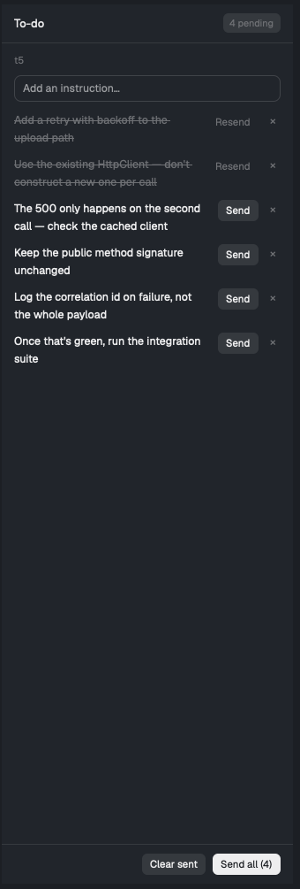

# To-do

A list of instructions you write for the agent you are looking at. You add
items as they occur to you while the agent works; nothing is sent until you
say so. Send one, or send every pending one as a single numbered message.
Sent items stay as a greyed record of what you already asked for.



## What you see

One panel, a column, 330 px wide (min 260, max 560), background `background`,
text `foreground`. Top to bottom:

1. **Header**, 44 px, padded 14 px, bottom border `border`. "To-do" at 13 px
   semibold on the left. When anything is pending, a pill on the right:
   `raised` background, 6 px radius, 11 px `dim` text, reading `N pending`.
2. **Scope line**, 11 px `dim`, truncated at 60 characters. The focused
   agent's `space_name · tab_name`, or the bare terminal address when the
   focused terminal is not an agent (a plain shell).
3. **Input**, 30 px, 8 px radius, 1 px `input` border, placeholder
   "Add an instruction…". Enter adds an item and clears the field.
4. **Error line**, 11.5 px, theme `danger`, only when the last action failed.
5. **List**, scrolling, 14 px side padding, with a vertical scrollbar. Each
   row is text on the left (12.5 px) and controls on the right. Pending text
   is `foreground`; sent text is `dim` and struck through. Each row has a
   send button and a `×`. Empty state: "Nothing yet. Type above and press
   Enter."
6. **Footer**, padded, top border `border`, right aligned. "Clear sent"
   (`raised`) appears only when something is sent. "Send all (N)" (`solid`)
   appears only when something is pending.

## How it behaves

- **Scope.** The panel always shows the list belonging to the focused
  terminal. Switching agents switches the list. Each terminal has its own.
- **Add.** Enter in the input appends an item, numbered from a per-file
  counter that never reuses a number. Blank input does nothing.
- **Send one.** The row button reads "Send" when pending and "Resend" when
  already sent — a sent item can always be sent again unchanged. It sends
  that item's text alone.
- **Send all.** Sends every *pending* item as one message, numbered
  `1.`, `2.`, … one per line. Sent items are never included, so resending is
  always deliberate.
- **While sending**, every send button drops to 45 % opacity and loses its
  click handler, and the one pressed reads "Sending…". A second click cannot
  start a second send.
- **Marking.** Items are marked sent only after the send reports success. A
  failure leaves them pending and puts the reason in the error line.
- **Edit.** Clicking an item's text replaces the row with an input holding
  that text, plus a Save button; Enter also saves. Saving *changed* text on a
  sent item clears its sent flag, because `sent` means "this exact text was
  sent" and that is no longer true. Saving unchanged text changes nothing.
- **Delete.** `×` removes a row. Remaining rows keep their numbers.
- **Clear sent** removes every sent row and leaves pending ones.
- Outside edits to the files are picked up: the folder is watched and the
  panel reloads.

## Built from

A single mod, `mods/todo/`, placed by the layout as its own block. `mod.json`
is `{ "place": "none", "title": "To-do" }`; the host layout adds a node with
`"content": {"mod": "todo"}` and usually binds a key to
`layout.toggle:<node id>`.

From `gpui-kit`: `View`, `div`. From `gpui-base`: `v_flex`, `h_flex`,
`InputState`, `Input`, `Scrollbar`. From `herdr`: `agents`, `focused`,
`readTextFile`, `writeTextFile`, `appHome`, `theme`, `hc`, `watchFolder`.
Also `fs/promises` for `mkdir` and `readdir`.

State is one JSON file per terminal at `${appHome()}/todo/<address>.json`,
with `/` in the address replaced by `_`:

```json
{ "terminal": "box/t7", "next": 4,
  "items": [ { "n": 1, "text": "…", "sent": true } ] }
```

Sending is `hc(["send", <terminal address>, <text>])`. The address carries the
machine, so this works for agents on other machines — unlike anything that
writes files on their side.

Writes are read-modify-write through `writeTextFile(path, text, expected)`,
retried up to three times, so a concurrent write is re-read rather than lost.

## Watch out

- **Read `focused().terminal`, not `focused().agent`.** `agent` only means
  something when a layout agent block has focus, and otherwise holds the last
  agent seen — read it first and the panel silently pins to a stale agent
  whenever a plain shell is focused, filing items against the wrong one.
- **`hc send` wraps agent-bound messages** in `<hc from="…">…</hc>`. There is
  no way to avoid it: it happens for every agent target regardless of caller,
  the API-only `caller` parameter changes the tag's contents but not its
  presence, and `hc keys` cannot type shifted characters. Sends to a plain
  shell arrive unwrapped. Agents act on the wrapped text normally.
- **Multi-line text is fine.** A newline-joined message reaches an agent as a
  single message with newlines intact. (A *shell* executes each line, so don't
  judge this by testing against bash.)
- **Guard re-entry on send.** Without a flag, a second click lands before the
  first marks anything sent and the agent receives the instruction twice.
- The inline editor reuses one `InputState` across rows, so only one row can
  be edited at a time; opening another abandons the first.
- Item numbers are display order, not sort keys; deleting leaves gaps.
- There is no undo. `×` and "Clear sent" are immediate.

## Done when

- Focusing two different agents shows two different lists, and a plain shell
  shows its own by terminal address.
- Enter on "hello" adds a row; the pill reads "1 pending".
- Clicking Send on it delivers "hello" to that terminal, the row goes grey and
  struck through, its button becomes "Resend", and the pill disappears.
- Clicking Resend delivers "hello" again and the row stays sent.
- With three pending, "Send all (3)" delivers one message numbered 1–3 and
  greys all three; a sent fourth item is not included.
- Clicking a sent row's text, changing it, and saving un-greys it and returns
  it to the pending count.
- Killing the target terminal and pressing Send leaves the row pending and
  shows a reason in the error line.
- Restarting the app restores every list.
